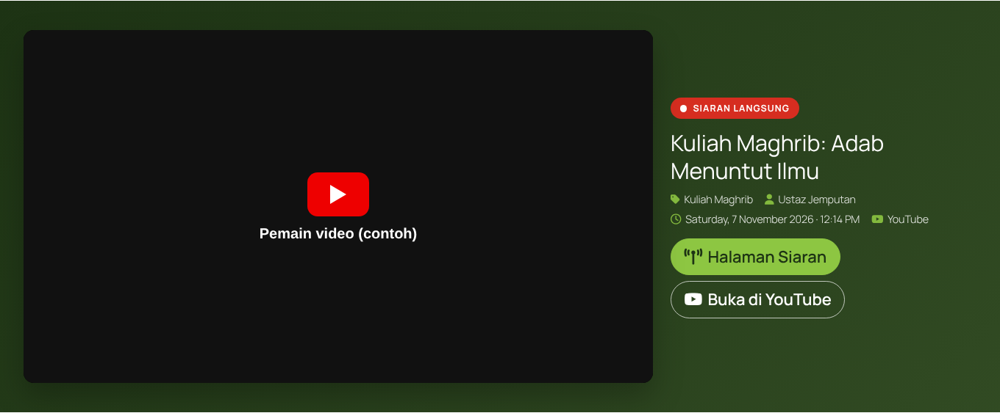
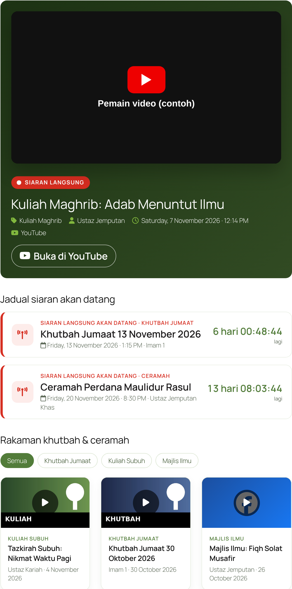
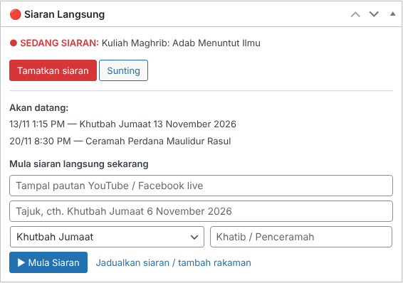
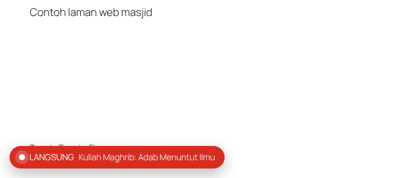
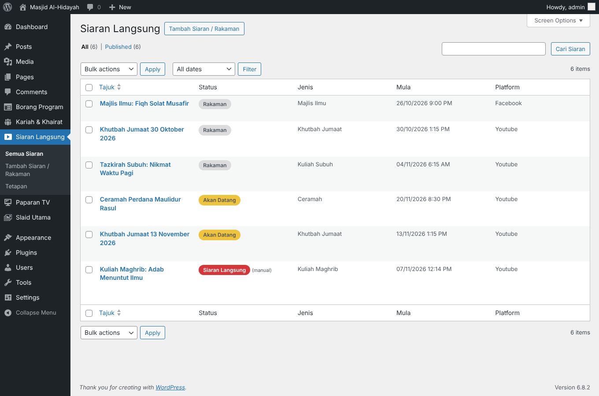
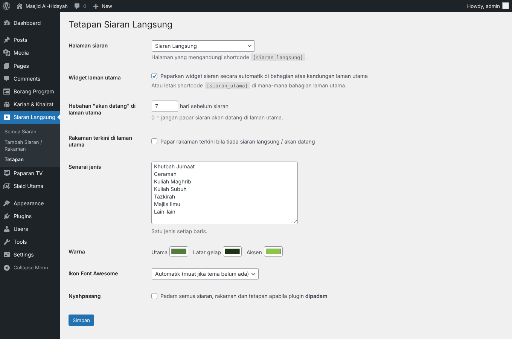

# Siaran Langsung Masjid

Plugin WordPress untuk **siaran langsung dan rakaman khutbah, ceramah & kuliah masjid / surau** dari YouTube atau Facebook. AJK hanya tampal pautan live di Papan Pemuka dan klik **▶ Mula Siaran** — siaran terus muncul di laman utama, di halaman siaran, dan sebagai butang **LANGSUNG** terapung di halaman lain. Selepas tamat, siaran menjadi rakaman dalam galeri.

*A WordPress plugin for Malaysian mosques to show live and recorded sermons and talks from YouTube or Facebook: paste the live link in the dashboard widget and press "Mula Siaran"; a live player appears on the home page, a broadcast page lists the schedule (with countdowns) and a filterable recordings gallery, and a floating LIVE pill shows on other pages. Works on any theme. UI is in Bahasa Melayu.*

## Ciri-ciri

- **Papan Pemuka → 🔴 Siaran Langsung**: tampal pautan, tajuk, jenis & penceramah → **Mula Siaran**; butang **Tamatkan siaran** apabila selesai
- **Jadualkan** siaran dengan tarikh, masa dan tempoh — mod *Automatik* menjadikannya siaran langsung pada masanya dan rakaman selepas tamat; mod paksa *Sedang siaran* / *Tamat*
- **Widget laman utama**: pemain siaran langsung, atau kad "akan datang" dengan **kiraan detik** (N hari sebelum), atau rakaman terkini (pilihan)
- **Halaman siaran** `[siaran_langsung]`: siaran semasa, jadual akan datang, galeri rakaman dengan tapisan jenis dan halaman — video hanya dimuatkan apabila diklik (laman kekal laju)
- **Butang LANGSUNG terapung** di halaman lain semasa siaran berlangsung
- YouTube: `watch?v=`, `youtu.be/`, `/live/ID`, `/shorts/`, `/embed/`, dan `youtube.com/channel/UC…/live` (sentiasa memaparkan siaran semasa saluran). Facebook: mana-mana pautan video awam. Pemain YouTube melalui **youtube-nocookie.com**
- Senarai jenis boleh diubah (Khutbah Jumaat, Ceramah, Kuliah Maghrib, Kuliah Subuh, Tazkirah, Majlis Ilmu …), warna mengikut masjid

| Halaman siaran | Papan Pemuka | Butang terapung |
|---|---|---|
|  |  |  |

| Senarai siaran | Tetapan |
|---|---|
|  |  |

## Pemasangan

1. Muat turun **`siaran-langsung-masjid.zip`** dari halaman [Releases](../../releases/latest).
2. wp-admin → **Plugins → Add New → Upload Plugin** → pilih zip → **Install Now** → **Activate**.
3. **Siaran Langsung → Tetapan** → **Cipta halaman "Siaran Langsung"**, pilih warna, dan tandakan *Widget laman utama* (atau letak `[siaran_utama]` di laman utama).
4. Tambah halaman siaran ke menu.
5. Bila siaran bermula: **Papan Pemuka → 🔴 Siaran Langsung → Mula Siaran**.

### Shortcode

| Shortcode | Fungsi |
|---|---|
| `[siaran_langsung]` | Halaman penuh: siaran langsung, jadual, rakaman |
| `[siaran_utama]` | Widget laman utama (kosong jika tiada siaran / jadual) |

### Penting

- Video Facebook mesti **Awam (Public)** untuk dipaparkan.
- YouTube tidak membenarkan *embed* menggunakan `@handle/live` — guna pautan video atau `youtube.com/channel/UC…/live`.
- Jika laman menggunakan Content-Security-Policy, benarkan `frame-src` untuk `www.youtube-nocookie.com` dan `www.facebook.com`, serta `img-src` untuk `i.ytimg.com`.
- Tema yang menyediakan hook `perepat_front_after_prayer` memaparkan widget di bawah waktu solat secara automatik.

## Keperluan

WordPress 6.4+ · PHP 7.4+. Diuji pada tema blok **Twenty Twenty-Five** dan tema klasik.

## Menyahpasang

Memadam plugin **tidak** memadam siaran & rakaman secara lalai. Tandakan **Tetapan → Nyahpasang** untuk membuang semuanya.

## Berpindah dari binaan khusus (Perepat Siaran Langsung)

Data dikongsi (jenis kandungan `mp_siaran`, `ps_settings`). Nyahaktifkan plugin lama, kemudian aktifkan plugin ini.

## Lesen

GPL-2.0-or-later © Mohd Nordin Hussain
